# Tutorial — the design and the testbenches

A guided, internals-level tour of **what the RTL does, block by block**, and **how
the two testbenches verify it**. Read this once to understand the machine itself;
read **`docs/TUTORIAL.md`** for the *environment* (what runs where, every `make`
target, troubleshooting). This doc complements the others and tries not to repeat
them:

- **`PLAN.md`** — scope, the frozen FDI/PIPE boundary contract, the phased build-out.
- **`docs/ucie2_pipe71_spec_crosscheck.md`** — every frozen encoding, cited.
- **`docs/verification_plan.md`** — the DV plan at a glance.
- **`docs/TUTORIAL.md`** — the environment & commands.
- **this file** — the design and the DV mechanism, in depth.

Signal and module names below are real; a few carry a `file:line` anchor. If an
anchor has drifted, trust the name and `grep`.

---

## Part 0 — the one-sentence mental model

The bridge turns a **UCIe 2.0 FDI** flit stream (controller / Protocol-Layer
facing) into a **PCIe PIPE 7.1** MAC-facing wire stream, and back, across **two
clock domains**, at **Gen5 (128b/130b) or Gen6 (PAM4 raw)** line rates — and the
DV proves it by running **two independently-written testbenches** on the **same
stimulus** and diffing their **per-cycle traces byte-for-byte**.

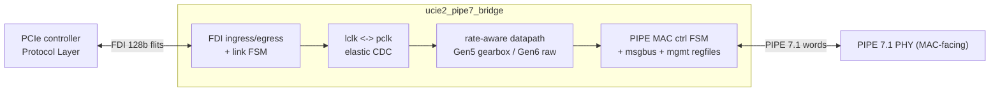

Two domains, one top module:

| Domain | Clock / reset | Blocks living there |
|--------|---------------|---------------------|
| **FDI / LPIF** ("lclk") | `lclk` / `lclk_rst_n` | `ucie2_fdi_ingress`, `ucie2_fdi_egress`, `ucie2_fdi_link_fsm`, the lclk side of both CDC buffers |
| **PIPE / PCLK** ("pclk") | `pclk` / `pclk_rst_n` | `pipe7_mac_datapath_ra` (framer/deframer/gen6), `pipe7_rx_burst_fifo`, `pipe7_mac_ctrl_fsm`, `pipe7_msgbus_master`, `ucie2_mgmt_sideband`, both `pipe7_regfile`s |

The crossing is done by two `pipe7_cdc_elastic_buf` instances. In simulation both
clocks are a coincident 2 ns period, so the system is effectively synchronous — but
the RTL is written for a true asynchronous crossing.

---

# Part I — the design (RTL in `rtl/`)

15 SystemVerilog files. The top is **`ucie2_pipe7_bridge.sv`**; shared types live
in the frozen package **`ucie2_pipe7_pkg.sv`**.

## 1. The frozen contract — `ucie2_pipe7_pkg.sv`

Everything downstream builds on the package, and **its encodings are frozen** (PLAN
Item 0; each literal is cited in the spec cross-check). The load-bearing pieces:

**The internal block.** A UCIe FDI transfer is 128 bits (`FDI_DW = 128`), and it
maps **1:1** to an internal block of `{is_os, data128}`:

- `BLOCK_PAYLOAD = 128`, `SYNC_HDR_BITS = 2`, `BLOCK_BITS = 130`.
- Sync-header literals: `SYNC_HDR_DATA = 2'b10`, `SYNC_HDR_OS = 2'b01`.
- The CDC/FIFO entry width is `PWID = BLOCK_PAYLOAD + 1 = 129` — the extra bit is
  `is_os`. This single bit is why OS-vs-data flit typing survives the whole path.

**The enums you will meet** (members → values):

- `fdi_state_e` — `FDI_RESET=0, FDI_ACTIVE=1, FDI_L1=2, FDI_L2=3, FDI_LINKRESET=4,
  FDI_LINKERROR=5, FDI_RETRAIN=6, FDI_DISABLED=7`. `RESET=0` so reset lands in it.
- `rate_e` — in scope: `RATE_GEN5=4` (32 GT/s, 128b/130b) and `RATE_GEN6=5`
  (64 GT/s, PAM4 FLIT). Reset default is Gen5.
- `powerdown_e` — `PD_P0..PD_P2`; rate/width changes are legal only in P0/P1.
- `width_e` — `W_10..W_160`; `msgbus_cmd_e`, `sb_mgmt_op_e` — the two config planes.

**The register map** (`MB_ADDR_WIDTH=12`, 8-bit data):

- `REG_PHY_TX_CTRL_BASE = 12'h400` … `REG_PHY_PAM4_RESTRICTED_LEVELS = 12'h406` —
  the PHY-Tx-control shadow (where the Gen6 PAM4 knob lives).
- `REG_MGMT_BASE = 12'h010`, `MGMT_SPACE_SPAN = 16`, `NUM_MGMT_REGS = 8` — the
  UCIe-2.0 management window `0x010..0x01F` (only `0x010..0x017` physically backed,
  so an in-window miss returns a clean error completion).

## 2. The top — `ucie2_pipe7_bridge.sv`

The top is pure integration: it instantiates every submodule and wires the two
datapaths plus the two config planes. Parameters `FDI_W = 128`, `PW = 80` (the
active PIPE width the bridge passes down; the datapath modules default to 160).

The whole module at a glance — the two datapaths, the two clock domains, and the
two address-demuxed config planes:

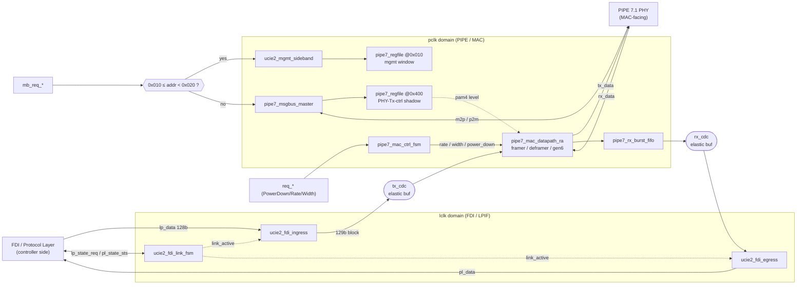

**Ports, by interface:** FDI TX (`lp_data/lp_valid/lp_irdy/lp_is_os`, `pl_trdy`
out), FDI RX (`pl_data/pl_valid/pl_is_os/pl_flit_cancel`), the FDI link handshake
(`lp_state_req/pl_state_sts`, `lp_linkerror`, `pl_stallreq/lp_stallack`, plus
rx-active/clk/wake), the PIPE command bus (`tx_data/tx_data_valid`,
`rate/power_down/width`, `tx_elec_idle`), the PIPE status bus
(`rx_data/rx_valid/phy_status/rx_status/rx_elec_idle`), the PIPE message bus
(`m2p_message_bus/p2m_message_bus`), the two mgmt request ports (`req_*` for
PowerDown/Rate/Width, `mb_req_*`/`mb_rsp_*` for register access), and the
observability outputs (`block_locked, sync_error, in_data_phase, rx_overflow`).

**The TX chain (ingress → egress order):**

```
lp_data ─▶ ucie2_fdi_ingress ─▶ tx_cdc (lclk→pclk) ─▶ pipe7_mac_datapath_ra ─▶ tx_data
             {is_os,data128}      129-bit entry         framer│gen6 by rate
```

**The RX chain:**

```
rx_data ─▶ pipe7_mac_datapath_ra ─▶ pipe7_rx_burst_fifo ─▶ rx_cdc (pclk→lclk) ─▶ ucie2_fdi_egress ─▶ pl_data
             deframer│gen6           absorbs 0/1/2 blk/clk     129-bit + error      {is_os,data128}
```

**Two config planes, address-demuxed.** A single `mb_req_*` port is routed by
address (`ucie2_pipe7_bridge.sv:155`):

```
mgmt_space = (mb_req_addr >= 0x010) && (mb_req_addr < 0x020)
  true  → ucie2_mgmt_sideband  (UCIe-2.0 sideband transport + mgmt regfile @0x010)
  false → pipe7_msgbus_master  (PIPE 7.1 M2P/P2M message bus; PHY-space writes also
                                write-through the PHY-Tx-control shadow regfile @0x400)
```

The response side is a mux (`mb_rsp_* = mgmt when mgmt_rsp_valid else mbus`), and
`mb_req_ready` is granted only when **both** planes are idle — one transaction
outstanding at a time.

**Rate gating** is a single idea applied in three places: `is_gen6 = (rate ==
RATE_GEN6)` selects the Gen6 raw path over the Gen5 gearbox for the CDC read-gate,
the TX mux inside the datapath, and the RX mux. The Gen5 default is byte-identical
because the Gen6 ports sit idle unless `rate` is switched to Gen6.

## 3. The TX datapath, block by block

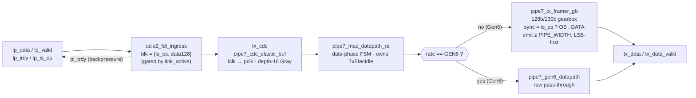

**`ucie2_fdi_ingress`** (lclk, combinational). One FDI transfer == one 128-bit
block. `pl_trdy = blk_ready & link_active`, `blk_valid = lp_valid & lp_irdy &
pl_trdy`, and crucially **`blk_is_os = lp_is_os`** — this is where the OS/data type
enters the pipe. Data only flows when the link FSM says `link_active`.

**`pipe7_cdc_elastic_buf` (tx_cdc)** (lclk→pclk). A depth-16 dual-clock FIFO with
**Gray-coded pointers** crossed through 2-FF synchronizers (`bin2gray`/`gray2bin`,
registered-output read side). It carries a **per-entry error bit** (`wr_error →
rd_error`) alongside the 129-bit data — unused on TX, but the same primitive uses
it on RX for flit-cancel (see §6).

**`pipe7_mac_datapath_ra`** (pclk) — the rate-aware wrapper. A small **data-phase
FSM** (`DP_IDLE/DP_DATA`, 2-cycle drain) gates the datapath: it enters `DP_DATA`
only when data is enabled **and** `power_down == PD_P0`, and it **owns TxElecIdle**
(`tx_elec_idle = active ? 0 : 0xF`, and `in_data_phase = active`) so TxDataValid can
never be asserted while the link is electrically idle. It instantiates all three
engines and muxes them by rate, **gating each engine's RX valid by its mode** so the
idle engine can never mis-lock.

**`pipe7_tx_framer_gb`** (Gen5). The 128b/130b framer ("gearbox"). It builds each
block as `{payload, sync}` where `sync = pl_is_os ? SYNC_HDR_OS : SYNC_HDR_DATA`
(so `is_os` becomes the sync header), accumulates blocks, and emits one
`PIPE_WIDTH`-bit word, **LSB-first**, whenever at least `PIPE_WIDTH` bits are
buffered. It accepts up to 2 blocks/clk; `pl_acc` reports how many it took.

**`pipe7_gen6_datapath`** (Gen6). A registered **raw pass-through** — *no* block
coding, *no* sync header, *no* alignment. Gen6 PIPE already carries encoded data;
flit/FEC/LCRC are controller-side and PAM4 precoding is PHY-side. Its only MAC-side
knob is `pam4_restricted_levels`, programmed over the msgbus and read from the
PHY-Tx-control shadow regfile.

## 4. The RX datapath, block by block

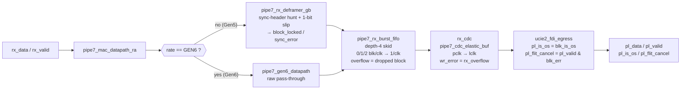

**`pipe7_rx_deframer_gb`** (Gen5). The 128b/130b deframer, and the **origin of
`block_locked` and `sync_error`**. It hunts for a legal sync header (`DATA` or
`OS`) with single-bit slip: a legal header → emit `pl_data/pl_is_os`, set
`block_locked`, recover up to 2 blocks/clk; an illegal header while locked →
`sync_error`, drop lock, slip one bit and retry. An accumulator-overflow flush
(unreachable on an aligned stream) also raises `sync_error`.

**`pipe7_rx_burst_fifo`** (pclk). A small (depth-4) skid FIFO that absorbs the
deframer's bursts: the deframer can hand over 0, 1, **or 2** blocks in one PCLK, but
the RX CDC drains only 1/PCLK. `accept = min(push_cnt, avail)`, and **`overflow =
(accept != push_cnt)`** — the dropped-block event that becomes `rx_overflow`.

**`pipe7_cdc_elastic_buf` (rx_cdc)** (pclk→lclk). Same primitive as tx_cdc, the
other direction — and here the per-entry error bit earns its keep: the bridge feeds
`wr_error = rx_overflow_q` so an overflow-tainted block carries an error flag all
the way to the lclk side.

**`ucie2_fdi_egress`** (lclk). One recovered block → one FDI transfer, with no
backpressure (FDI RX has none by spec). It drives `pl_is_os = blk_is_os` (recovering
the flit type) and **`pl_flit_cancel = pl_valid & blk_err`** — retracting any flit
that rode through an overflow.

## 5. The control / config plane

The two config planes share one request port, demuxed by address; the response is
muxed back:

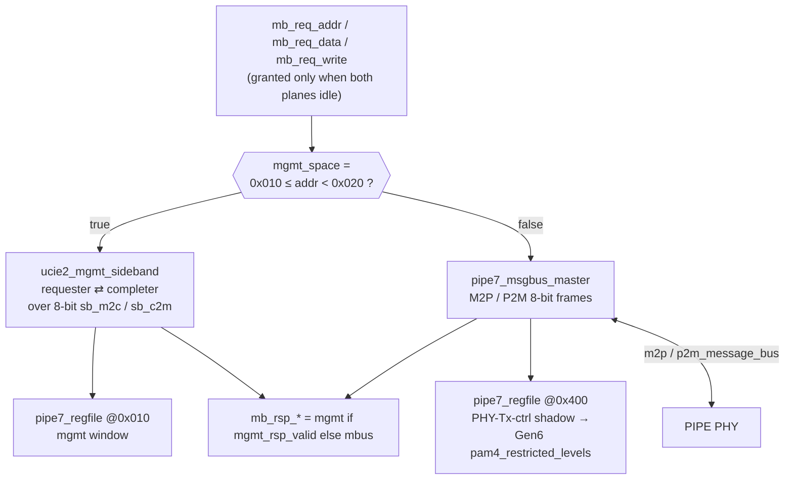

The FDI link state machine (`link_active` gates all datapath flow). Every
host-requested transition runs the LPIF stall handshake (assert `pl_stallreq`, wait
`lp_stallack`, then commit); `lp_linkerror` forces a sticky `FDI_LINKERROR` from any
state:

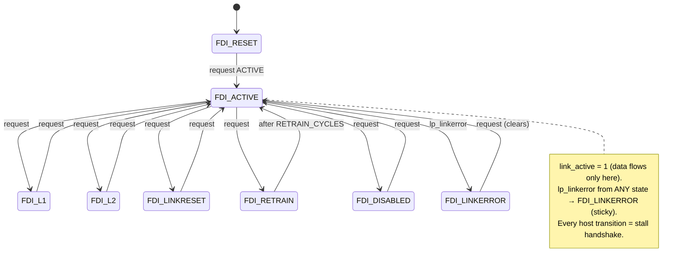

**`ucie2_fdi_link_fsm`** (lclk). The FDI/LPIF state machine. It produces
`link_active = (state_q == FDI_ACTIVE)` — the gate on all datapath flow. Host-driven
transitions use the LPIF stall handshake (assert `pl_stallreq`, wait `lp_stallack`,
then commit `state_q <= lp_state_req`); `lp_linkerror` forces sticky
`FDI_LINKERROR`; `FDI_RETRAIN` trains for `RETRAIN_CYCLES` then auto-returns to
ACTIVE. The round-trip only ever requests ACTIVE, so training phases never fire on
the sacred path (cold multi-phase bring-up is tracked as Phase J, item J3).

**`pipe7_mac_ctrl_fsm`** (pclk). Sequences PowerDown / Rate / Width changes against
the PHY `phy_status` handshake, with a legality check (`rate/width` change legal
only in P0/P1) and a 1024-cycle watchdog. While `busy`, it forces TxElecIdle high
(the top ORs this over the datapath's own EI). It pulses `done` on success,
`req_error` on an illegal request or a watchdog timeout.

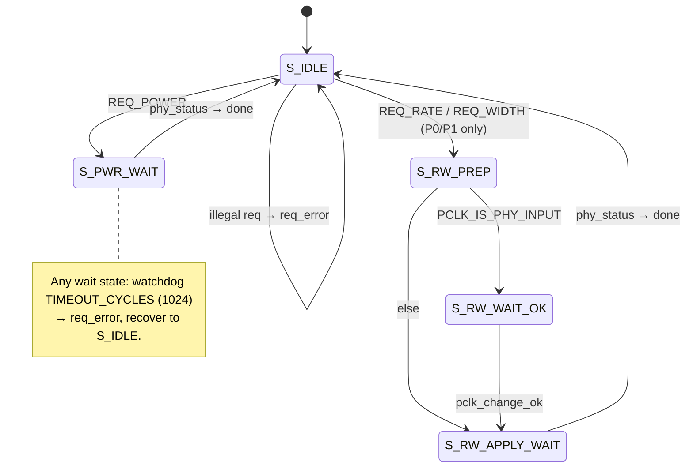

**`pipe7_msgbus_master`** (pclk). The PIPE 7.1 MAC↔PHY config master: an 8-bit
M2P/P2M FSM that frames read / write-committed / write-uncommitted transactions
(`byte0 = {cmd, addr[11:8]}`, `byte1 = addr[7:0]`, `byte2 = data`) and consumes
`MB_READ_COMPLETION` / `MB_WRITE_ACK` responses, with a watchdog. One outstanding
transaction. (Its write/timeout paths are only incidentally exercised today — Phase
J item J2 adds a directed test.)

**`ucie2_mgmt_sideband`** (pclk). The UCIe-2.0 management transport: a **requester**
FSM and a **completer** FSM wired back-to-back over an internal 8-bit sideband
(`sb_m2c`/`sb_c2m`), serialising register accesses and completing them against the
mgmt `pipe7_regfile`. A miss inside the decode window returns `SB_CPL_ERR` (→
`rsp_error`); a hit returns `SB_CPL_OK` + data.

**`pipe7_regfile`** (pclk, instantiated twice). A parameterizable 8-bit register
window: once as the PHY-Tx-control shadow (base `0x400`, snapshot feeds the Gen6
PAM4 level), once as the mgmt regfile (base `0x010`) behind the sideband completer.

## 6. The four observability/error signals — where they come from

These four outputs are the heartbeat the TBs watch:

| Signal | Born in | Meaning |
|--------|---------|---------|
| `block_locked` | `pipe7_rx_deframer_gb` | deframer has sync-header lock |
| `sync_error` | `pipe7_rx_deframer_gb` | illegal header while locked (or overflow flush) |
| `rx_overflow` | `pipe7_rx_burst_fifo.overflow` → sticky `rx_overflow_q` | RX skid FIFO dropped a block |
| `pl_flit_cancel` | `ucie2_fdi_egress` (`pl_valid & blk_err`) | the current RX flit rode through an overflow — retract it |

The chain that makes flit-cancel work is worth internalizing: overflow in the RX
burst FIFO → sticky `rx_overflow_q` → fed as `wr_error` into rx_cdc → carried
per-block as `rd_error` to lclk → `blk_err` in egress → `pl_flit_cancel`. The error
bit the CDC primitive carries (unused on TX) is exactly this path.

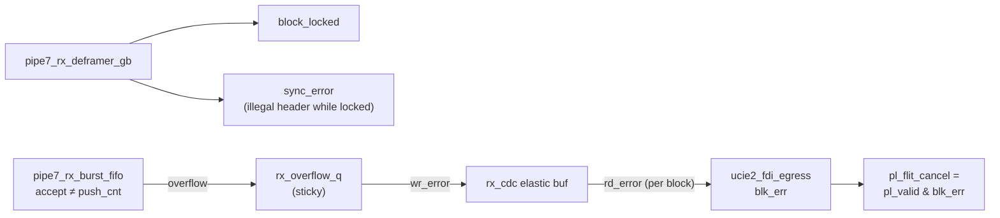

---

# Part II — the testbenches (DV in `dv/`)

## 7. The invariant everything serves

The RTL is verified by **two independently-authored, cycle-accurate** testbenches:

- **PyUVM-on-cocotb** (`dv/pyuvm/`) — runs locally and in CI.
- **SV UVM-on-Verilator** (`dv/uvm/sv/`, Cookbook one-class-per-file) — the full
  `--binary` run happens in CI/Railway.

They are kept honest **three** ways, so no single-TB bug can hide:

1. a **shared golden model** (`dv/common/models/`) both TBs self-check against,
2. a **shared stimulus vector** (`dv/common/vectors/build/`) both TBs read, and
3. a **per-cycle trace** both TBs emit, diffed byte-for-byte by
   `tools/trace_compare.py`.

If a trace diverges, the offending cycle+column is printed. If a TB disagrees with
the golden model, the bug is localized to exactly one of {DUT, SV-TB, Python-TB}.

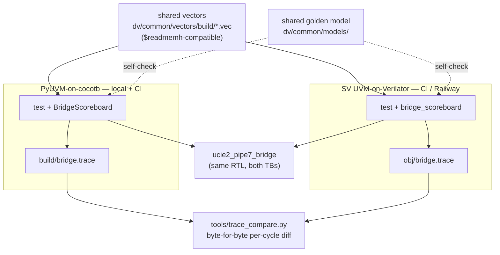

## 8. The shared golden model and vectors (`dv/common/`)

**Models** (`dv/common/models/`), written independently of the RTL:

- `framing_model.py` — the reference 128b/130b framer/deframer: `build_block`,
  `frame_stream(payloads, width)` (emits a word only once ≥ width bits buffered,
  mirroring the RTL's `fill >= PIPE_WIDTH`), `deframe_stream`, `sync_is_legal`. This
  is the class both TBs' scoreboards check against.
- `fdi_model.py` — FDI transfer ↔ 128-bit block (an identity map, since
  `FDI_DW == BLOCK_PAYLOAD`).
- `ctrl_plane_model.py` — `CtrlModel.predict(...)` mirrors `pipe7_mac_ctrl_fsm`
  legality (rate/width legal only in P0/P1).
- `coverage_model.py` — an **independent** functional-coverage model
  (`cocotb_coverage`), ~21 cover points → 53 honest bins.
- `trace_format.py` — the **single source of truth** for the single-bridge trace
  columns (`cycle, pl_state_sts, pl_valid, pl_trdy, pl_stallreq, pl_flit_cancel,
  tx_data_valid, tx_data, rate, power_down`). The SV emitter mirrors this list by
  hand.
- `b2b_trace_format.py` — the twin for the full-duplex B2B traces
  (`PCIE_FD_COLUMNS`, `UCIE_FD_COLUMNS`).

**Vectors** (`dv/common/vectors/gen_vectors.py`). Two profiles: `ramp` (the directed
`0x1000+i … / 0xABCD0000+i` regression) and `random` (seeded, reproducible, default
seed `0xC0FFEE`). The `.vec` file is `$readmemh`-compatible — one 128-bit payload per
line as 32 hex nibbles. **Both TBs read the same file:** PyUVM via `read_vec(VEC)`,
SV via `$readmemh` on `+VEC=<path>`. CLI knobs map to Make: `--n`=`LEN`,
`--seed`=`SEED`, `--profile`=`PROFILE`. There is also a block-aligned PIPE *word*
vector (`frame_words`) for the external-PCIe B2B config, whose SV tier has no framer.

## 9. The PyUVM tier (`dv/pyuvm/`)

**Components** (`agents/fdi_agent.py`, `env.py`):

- `FdiFlit` — one 128-bit transfer (`data`, `is_os`).
- `FdiDriver` — the FDI driver that **honors `pl_trdy` backpressure**: after reset
  it requests `FDI_ACTIVE`, waits the bring-up window, then drives one flit/lclk,
  holding `lp_valid/lp_irdy` until `pl_trdy` is high before completing the item. This
  is what lets any `LEN` round-trip without dropping flits.
- `FdiRxMonitor` (samples `pl_data` when `pl_valid`), `PipeTxMonitor` (samples
  `tx_data` when `tx_data_valid`, tracks lock + sync errors), `BridgeScoreboard`.

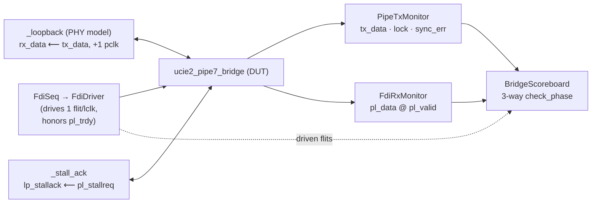

**The default round-trip (`test_roundtrip.RoundtripTest`).** `run_phase` starts two
coincident 2 ns clocks, resets, then `start_soon`s two helpers — `_loopback` (the
PHY model: `rx_data <= tx_data`, one pclk delay) and `_stall_ack` (`lp_stallack <=
pl_stallreq`) — and starts the flit sequence. A flit's life:

```
FdiDriver.drive  →  framer  →  tx_data  →  _loopback (PHY)  →  rx_data  →  deframer  →  pl_data (FdiRxMonitor)
   DRIVE                         TXWORD                                                    RECOVER
```

The **trace** is emitted by `run_phase` itself: it writes `TRACE_HEADER`, then for
each of `RUN_PCLK` cycles waits a `pclk` edge and writes one `format_row`. Values are
read just after the edge (the `_i()` helper returns settled post-edge values — the
cocotb equivalent of the SV `#0.1`).

**The 3-way self-check** (`BridgeScoreboard.check_phase`): (1) recovered flits ==
driven flits; (2) the DUT's `tx_data` stream == `framing_model.frame_stream(driven)`
bit-for-bit; (3) an independent `deframe_stream` of the DUT's own TxData == driven,
and every sync header legal. Plus `sync_errors == 0` and `saw_lock`.

**Specialized tests** (each targets one Phase-I feature; none writes the sacred
`bridge.trace`, so they're independent of the cross-check):

| Test | `make` | What it proves |
|------|--------|----------------|
| `test_is_os` | `is-os` | OS/data interleave; `pl_is_os` recovered per flit |
| `test_link_fsm` | `link-fsm` | the link FSM: bring-up, RETRAIN, L1/L2/LINKRESET/DISABLED, LINKERROR + recovery |
| `test_flit_cancel` | `flit-cancel` | forces a real RX-FIFO overflow (PW=160); `rx_overflow` + `pl_flit_cancel` retract |
| `test_mgmt` | `mgmt` | mgmt/sideband reg R/W, unbacked-addr error, PHY-space msgbus regression |
| `test_err_inject` | `err-inject` | PIPE RX lock → illegal garbage (sync_error, loss of lock) → re-lock |
| `test_gen6` | `gen6` | Gen6 raw pass-through + live Gen5→Gen6 rate switch (PW=160) |
| `test_fcov` | `fcov` | independent functional coverage (Icarus in CI); seeded CRV |
| `test_b2b_*` | `b2b` | two-bridge configs (see §12) |

## 10. The SV UVM tier (`dv/uvm/sv/`)

**Cookbook layout, one package.** `ucie2_pipe7_uvm_pkg.sv` imports `uvm_pkg` +
`ucie2_pipe7_pkg`, defines the run localparams (`N_FLITS`, `BRINGUP_LCLK`,
`RUN_PCLK`, `PW`, `FDIW`), and pulls every class in via an **ordered `` `include ``**
list — item → sequencer → sequence → driver/monitor → agent, **both agents before
env, env before test**:

```
fdi_agent/{fdi_flit_item, fdi_sequencer, fdi_seq_lib, fdi_driver, fdi_monitor, fdi_agent}.sv
pipe_agent/{pipe_monitor, phy_loopback, pipe_agent}.sv
env/{bridge_scoreboard, bridge_env}.sv
test/ucie2_roundtrip_test.sv          ← LAST
```

The classes mirror the PyUVM ones: `fdi_driver.drive()` honors `pl_trdy`;
`phy_loopback.run()` reproduces the cocotb VPI latency (a 1-cycle shadow → net
2-cycle delay) so the two TBs line up; `bridge_scoreboard` checks no sync_error,
reached lock, and rx == expected. The DUT boundary is the `ucie2_pipe7_if.sv` bundle
(with `lp_state_req` initialised to `FDI_RESET` so cycle 0 doesn't diverge);
`tb_ucie2_pipe7.sv` is the top.

**The sacred emitter — `test/ucie2_roundtrip_test.sv`.** This file is what keeps the
two traces byte-identical; **never restructure its `run_phase`**. The proven
orchestration:

1. Idle all inputs during reset and read the `+RUN_PCLK`/`+TRACE` plusargs (zero
   sim-time) and write the hand-mirrored header.
2. `wait (vif.pclk_rst_n === 1'b1)`.
3. **Sample cycle 0 *before* the fork** (`@(posedge pclk); #0.1; $fwrite(...)`) — so
   cycle 0 sees reset-state inputs, exactly as cocotb's `start_soon` does.
4. `fork ... join_none` in the exact order: `loopback.run`, `driver.stall_ack`,
   `tx_mon.capture`, `rx_mon.capture`, `driver.drive`, `seq.start`.
5. `for (cyc=1; cyc<run_pclk; cyc++) @(posedge pclk); #0.1; $fwrite(...)`.

The **`#0.1` post-edge sampling** (in every forked task and the trace loop) reads
settled, registered values after the edge — the SV equivalent of cocotb's post-edge
reads. Fork order + `#0.1` + the shared column list == a byte-identical trace.

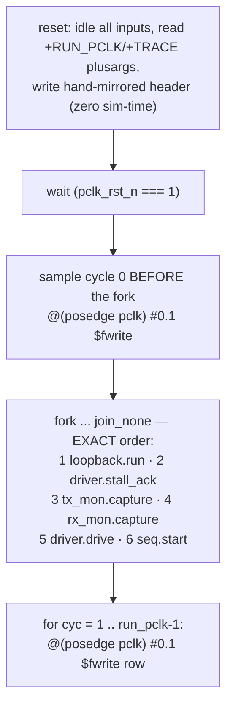

**Bound SVA — `ucie2_pipe7_sva.sv`.** A logic-free checker `bind`-ed onto the bridge
boundary, carrying properties like `a_no_tx_while_elec_idle` (qualified by `!busy`),
`a_lock_is_sticky`, `a_no_sync_error_once_locked`, `a_stallreq_held_until_ack`,
`a_state_change_handshaked`, `a_no_rx_overflow`. It lives **outside** `rtl/` (so the
Icarus/lint wildcard never sees it) and is activated only in the Verilator
`--binary` build via `--assert`.

**The flows.** `dv/uvm/vlt/Makefile` drives Verilator: `make lint` is the RAM-safe
`--lint-only` elaborate (local + CI); `make run` is the full `--binary` build+run,
gating on any `UVM_ERROR/FATAL` or `[SVA]` line (CI/Railway only — it OOMs a small
box). `dv/uvm/vcs/` is a reserved placeholder for a Synopsys VCS mirror (Phase J
item J6).

## 11. The trace-compare gate (`tools/trace_compare.py`)

The literal cycle-accurate gate. It loads both traces (one CSV line per PCLK, the
`trace_format` columns) and fails on: a header mismatch (exit 2), the **first**
divergent cycle — printing each differing `col: pyuvm=.. uvm=..` (exit 1), or a
length mismatch. On success it prints "N cycles identical across both TBs".

- `make trace-compare` diffs `dv/pyuvm/build/bridge.trace` vs
  `dv/uvm/vlt/obj/bridge.trace` (CI/Railway, after the SV `--binary` run).
- `make trace-compare-b2b` runs it per full-duplex B2B tier (`b2b_ucie_fd`,
  `b2b_pcie_fd`), using `b2b_trace_format`.

## 12. The back-to-back harness (`dv/harness/`)

The B2B configs join **two** `ucie2_pipe7_bridge` instances so the bridge is checked
against itself — a strong end-to-end test. Two seam choices × unidirectional/full-
duplex:

| File | Seam joined | External ends | Direction |
|------|-------------|---------------|-----------|
| `b2b_ucie_pcie_ucie.sv` | **PIPE** (`A.tx_data`→`B.rx_data`) | UCIe/FDI | A→B |
| `b2b_pcie_ucie_pcie.sv` | **FDI** (`A.pl_data`→`B.lp_data`) | PCIe/PIPE | A→B |
| `b2b_ucie_pcie_ucie_fd.sv` | PIPE, both directions | UCIe/FDI | full-duplex |
| `b2b_pcie_ucie_pcie_fd.sv` | FDI, both directions | PCIe/PIPE | full-duplex |

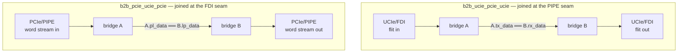

The `_fd` variants add the reverse direction over the same seam (drive + check both
ways at once) and are the tiers the `trace-compare-b2b` gate covers.

Joining at the **PIPE** seam means a UCIe flit into A is framed, crosses the real
PIPE link, and is recovered by B as a UCIe flit. Joining at the **FDI** seam means a
pre-framed PIPE word stream into A is deframed to a flit, crosses the real FDI seam,
and is re-framed by B. The `_fd` variants run forward+reverse at once and are the
tiers the `trace-compare-b2b` gate covers. (The B2B seam currently ties `is_os = 0`
— threading it is Phase J item J1.) Harness files live outside `rtl/`, so the
single-bridge gate and the sacred emitter are untouched.

---

## 13. Worked example — follow one flit, end to end

Tie it together. A single data flit `0x…` driven at Gen5:

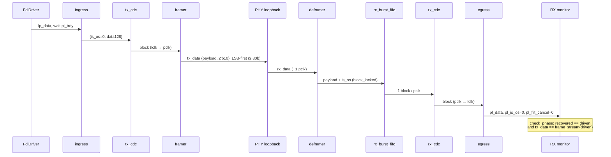

1. **Driver** holds `lp_valid/lp_irdy` and the payload on `lp_data`, waits for
   `pl_trdy`. (`FdiDriver` / `fdi_driver.drive`.)
2. **Ingress** (`link_active`) forms `{is_os=0, data128}` and asserts `pl_trdy`;
   the block is written into **tx_cdc**.
3. tx_cdc crosses lclk→pclk; the datapath reads it, the **framer** wraps it as
   `{payload, 2'b10}` and shifts it out LSB-first as `tx_data` once 80 bits are
   buffered (`tx_data_valid`).
4. The **PHY loopback** returns it as `rx_data` one pclk later.
5. The **deframer** hunts the sync header, locks (`block_locked`), recovers the
   128-bit payload + `is_os`, hands it to the **rx burst FIFO**.
6. The FIFO drains one block into **rx_cdc** (pclk→lclk); **egress** presents it as
   `pl_data/pl_valid`, `pl_is_os=0`, `pl_flit_cancel=0`.
7. The **RX monitor** captures it; `check_phase` asserts it equals the driven flit,
   and that the DUT's `tx_data` matched `framing_model.frame_stream`.
8. Every PCLK of all this was written to `bridge.trace` by both TBs — and
   `trace_compare` proves the two files are byte-identical.

## Where to go next

- **`docs/TUTORIAL.md`** — run all of the above: every `make` target and where it runs.
- **`PLAN.md`** §7 — the phased build-out, incl. the Phase J backlog.
- **`docs/phase_i_design_completion.md`** — how the four FLAGGED contract items were
  resolved (the `is_os`, `pl_flit_cancel`, link-FSM, and mgmt/sideband work above).
- **`docs/ucie2_pipe71_spec_crosscheck.md`** — every frozen encoding, cited.
- **`make help`** — the authoritative target list.
